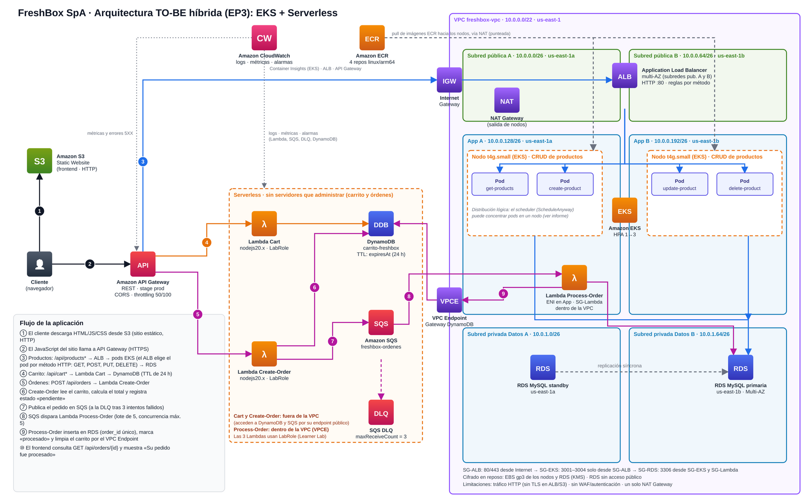
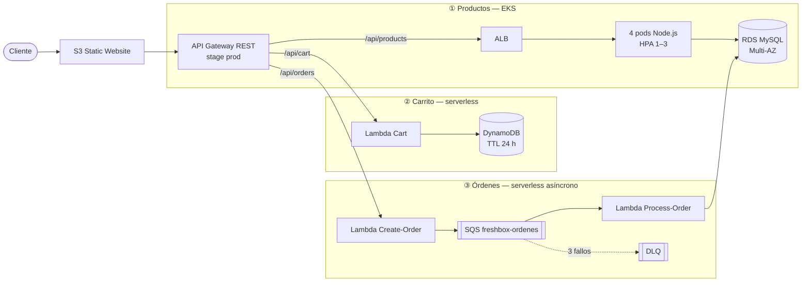
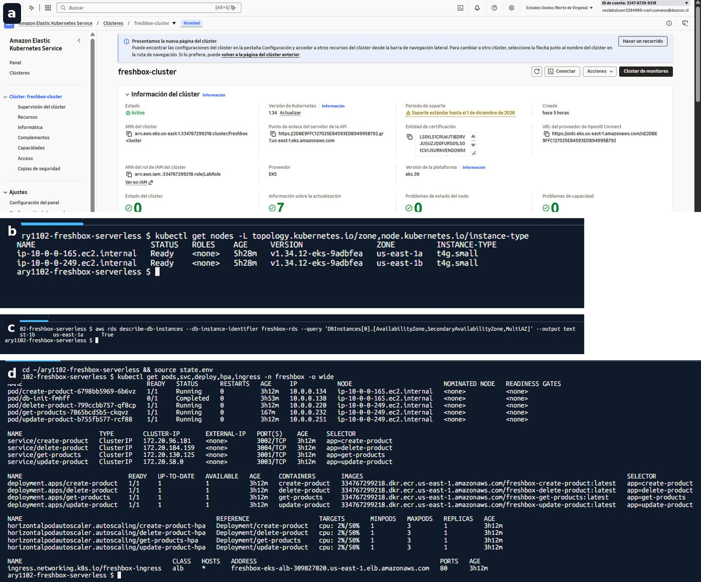
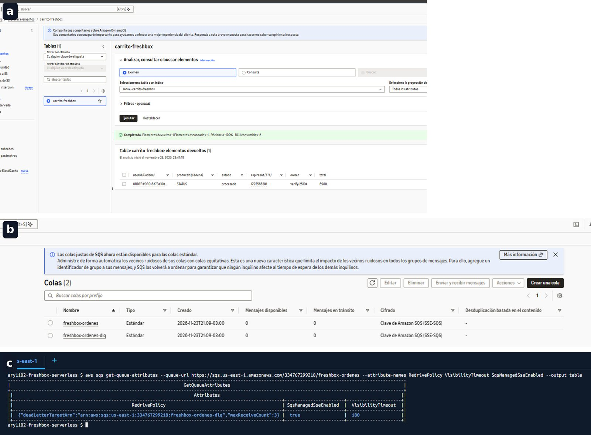
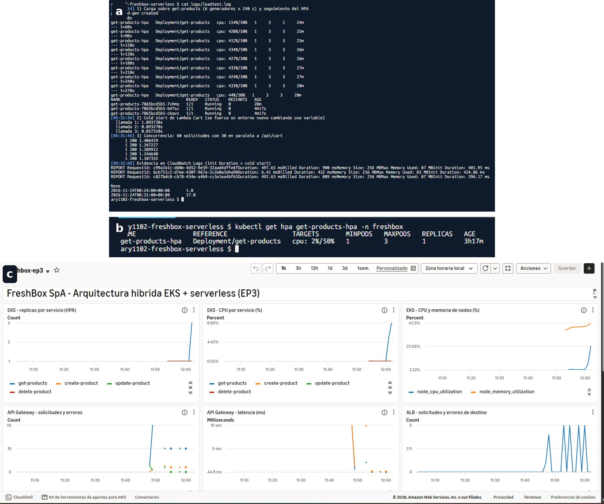
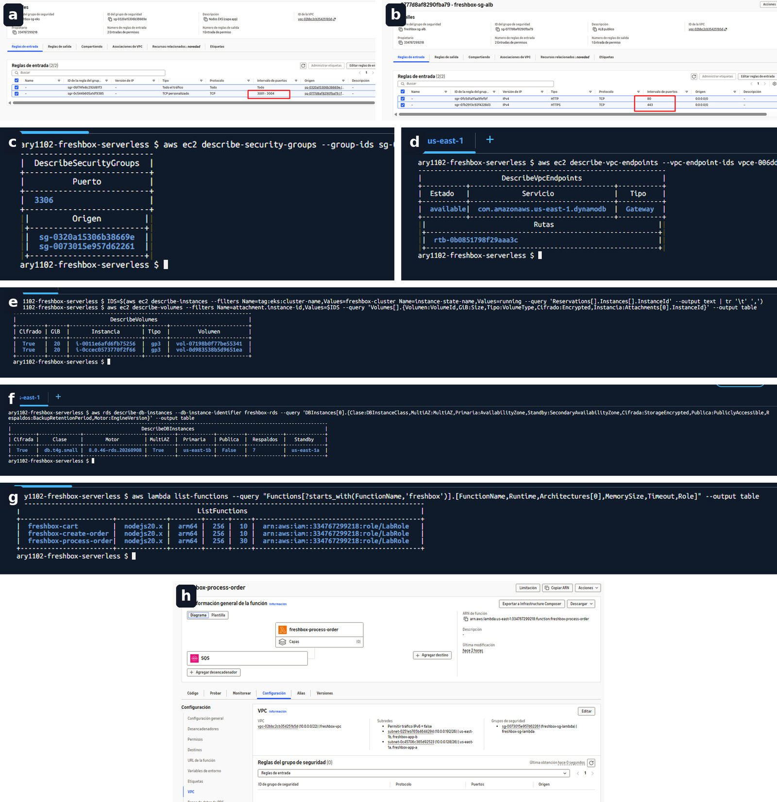
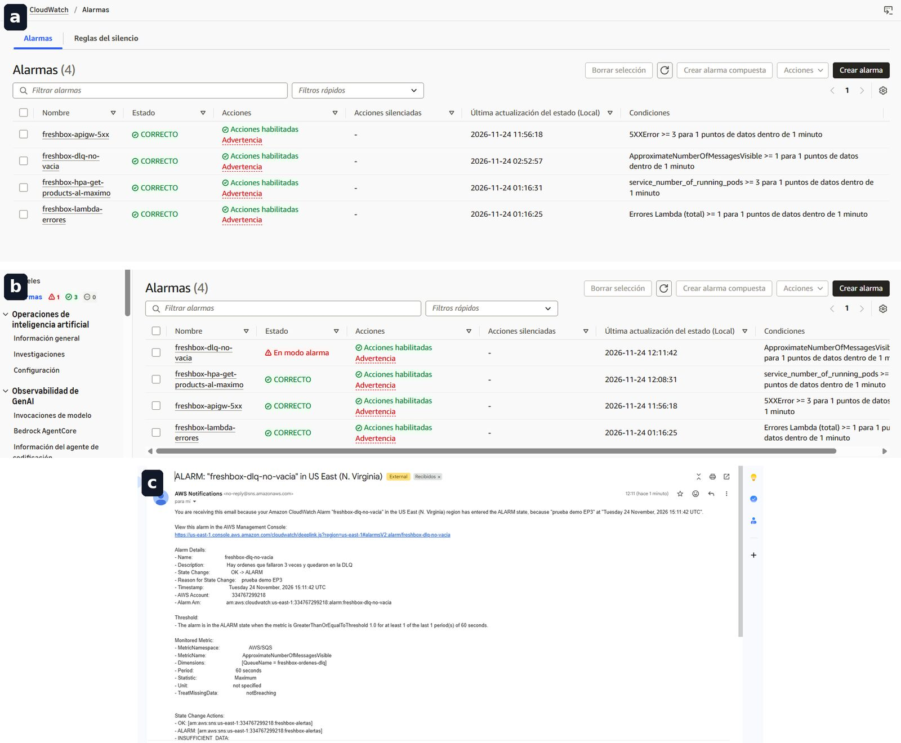
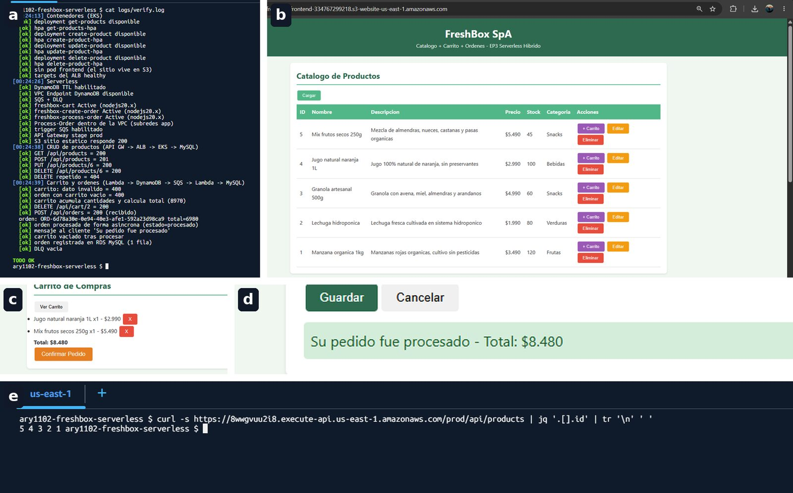

<div align="center">

# 🥬 FreshBox SpA — Arquitectura híbrida EKS + Serverless

**De un catálogo en Kubernetes a una plataforma e-commerce con carrito y órdenes desacopladas, desplegada como código en AWS.**


*Evaluación Parcial N°3 · ARY1102 Arquitectura Cloud · Duoc UC*
*Carlos Rodrigo Cuevas Núñez · Docente: Rodrigo Horacio Aguilar González*

[📄 Informe técnico (PDF)](docs/Informe_Tecnico_EP3.pdf) · [🏗️ Diagrama TO-BE](docs/arquitectura-to-be.png) · [🚀 Cómo reproducirlo](#-cómo-reproducirlo) · [🧪 Evidencia](#-evidencia)

</div>

---

## ⚡ En 30 segundos

FreshBox tenía un catálogo de productos en **Amazon EKS** (EP2). La gerencia pidió vender: **carrito, cálculo del total y confirmación de órdenes**, sin disparar costos. La solución es un modelo **híbrido**:

| Se queda en **EKS** | Pasa a **serverless** |
|---|---|
| CRUD de productos (4 microservicios Node.js) | Carrito: **Lambda + DynamoDB** con TTL de 24 h |
| Base relacional **RDS MySQL Multi-AZ** | Órdenes: **Lambda + SQS** (con cola de mensajes fallidos) |
| ALB con reglas por método HTTP | Frontend estático en **S3** · puerta de entrada **API Gateway** |

> **Regla de diseño:** EKS donde hay estado relacional y tráfico constante; serverless donde hay ráfagas, datos efímeros o trabajo asíncrono.

## 🏗️ Arquitectura TO-BE



### Los tres flujos



## 🧩 Qué hace cada pieza

| Capa | Servicio | Responsabilidad |
|---|---|---|
| Frontend | **S3** Static Website | HTML, CSS y JS del sitio (reemplaza al pod de frontend) |
| API | **API Gateway** REST | Ruteo a ALB y Lambdas, CORS, throttling 50/100 |
| Productos | **EKS** + ALB | `get`, `create`, `update` y `delete-product` sobre MySQL |
| Carrito | **Lambda Cart** + **DynamoDB** | Agregar, quitar y consultar; expira solo (TTL `expiresAt`) |
| Órdenes | **Lambda Create-Order** → **SQS** → **Lambda Process-Order** | Calcula el total, encola y registra la orden de forma idempotente |
| Datos | **RDS MySQL** Multi-AZ | Productos y órdenes (cifrado, sin acceso público) |
| Red | VPC `/22`, 6 subredes, 1 NAT, 4 Security Groups | Segmentación por capas · **VPC Endpoint** (gateway) a DynamoDB |
| Observabilidad | **CloudWatch** + SNS | Dashboard de 13 paneles y 4 alarmas con aviso por correo |

## 📊 Resultados medidos

| Qué | Resultado |
|---|---|
| Verificación automática (`verify.sh`) | **35 / 35 comprobaciones OK** |
| Escalado de pods (HPA) | CPU **154 % → 428 %** del objetivo · **1 → 3 réplicas** · vuelve a 1 |
| Concurrencia Lambda | **17** ejecuciones simultáneas |
| Cold start | **1,09 s** la primera llamada vs **0,06–0,09 s** en caliente |
| Costo base de la plataforma (2 nodos) | ≈ **US$201 / mes**, fijo |
| Costo extra de la parte serverless | **US$0,8 · 8,1 · 82** al mes con 0,17 · 1,7 · 17 millones de llamadas |
| Un nodo EKS adicional | US$13,86 / mes → punto de equilibrio ≈ **2,9 M** llamadas/mes |

> Los costos son estimaciones con precios de lista de `us-east-1`; los supuestos están en el [informe](docs/Informe_Tecnico_EP3.pdf).

## 🚀 Cómo reproducirlo

Todo se crea con scripts **idempotentes** desde **CloudShell** en un AWS Academy Learner Lab (`us-east-1`, rol `LabRole`). Cada script guarda sus IDs en `state.env` y las credenciales de BD en `.secrets.env` (ambos **fuera** del repositorio).

```bash
git clone https://github.com/carlcuevas/ary1102-freshbox-serverless.git
cd ary1102-freshbox-serverless
for s in 00 01 02 03 04 05; do ./scripts/$s-*.sh 2>&1 | tee logs/$s.log; done   # base (equivale al EP2)
for s in 06 07 08 09 10 11 12; do ./scripts/$s-*.sh 2>&1 | tee logs/$s.log; done # EP3
./scripts/verify.sh        # debe terminar en TODO OK
```

| Fase | Script | Qué hace | Tiempo aprox. |
|---|---|---|---|
| **A · Base** | `00-preflight.sh` | Herramientas, cuenta y `LabRole` | 1 min |
| | `01-network.sh` | VPC /22, 6 subredes, IGW, NAT, rutas, 4 SG | 3–5 min |
| | `02-rds.sh` | RDS MySQL Multi-AZ cifrado | 1 min |
| | `03-eks.sh` | Clúster + Node Group `t4g.small` (EBS cifrado) | 15 min |
| | `04-addons.sh` | metrics-server, CloudWatch Observability, LB Controller, Cluster Autoscaler | 5 min |
| | `05-db-init.sh` | Carga productos y órdenes, crea usuario de la app | 5–10 min |
| **B · EP3** | `06-images.sh` | Construye y sube 4 imágenes **arm64** a ECR | — |
| | `07-eks-apps.sh` | 4 pods + HPA + Ingress por método HTTP | — |
| | `08-data.sh` | DynamoDB con TTL, SQS + DLQ, VPC Endpoint | — |
| | `09-lambdas.sh` | Cart, Create-Order, Process-Order + trigger SQS | — |
| | `10-apigw.sh` | API REST, CORS, stage `prod` | — |
| | `11-frontend.sh` | Publica el sitio en S3 | — |
| | `12-monitoring.sh` | Dashboard, alarmas, SNS, retención de logs | — |
| **Operación** | `verify.sh` | Prueba de extremo a extremo (35 checks) | 2 min |
| | `loadtest.sh` | Carga para HPA, concurrencia y cold start | — |
| | `nodes.sh pause\|resume` | Apaga o enciende los nodos entre sesiones | — |
| | `backup.sh` | Respaldo del proyecto | — |

> 💡 Tras pausar el laboratorio: `./scripts/nodes.sh resume`, esperar ~2 min a que los *targets* del ALB queden sanos y volver a correr `verify.sh`.

## 🗂️ Estructura del repositorio

```text
.
├── scripts/            # Infraestructura como código (00 → 12, verify, loadtest, nodes, backup)
├── app/
│   ├── microservicios/ # get / create / update / delete-product (Node.js, Dockerfile)
│   ├── lambda/         # cart · create-order · process-order (Node.js 20)
│   └── frontend/       # Sitio estático que se publica en S3
├── k8s/                # Job de inicialización de BD, plantilla de servicios y Ingress
├── sql/                # Esquema y datos: productos y órdenes
├── build/              # Artefactos de despliegue (OpenAPI, política, empaquetado)
├── logs/               # Salida real de cada script y de las verificaciones
├── docs/               # Informe técnico, diagrama TO-BE y capturas de evidencia
└── config.env          # Configuración central (sin secretos)
```

## 🔐 Seguridad

- **Security Groups encadenados:** ALB → nodos EKS → RDS; RDS solo acepta tráfico desde EKS y Lambda.
- **Cifrado en reposo:** volúmenes EBS, RDS y SQS (SSE-SQS).
- **VPC Endpoint** de tipo gateway hacia DynamoDB, solo en la tabla de rutas de la capa de aplicación.
- **Usuario de aplicación sin `DROP`**; credenciales fuera del repositorio.
- **Brechas reconocidas** (detalladas en el informe): tráfico HTTP, API sin autenticación ni WAF, `LabRole` compartido por las tres Lambdas (en el Learner Lab no se pueden crear roles; el diseño de mínimo privilegio está en el Anexo A), un solo NAT y EKS 1.34 con soporte estándar hasta el 2 de diciembre de 2026.

## 🧪 Evidencia

<table>
<tr>
<td width="50%"><b>Plataforma base</b><br/></td>
<td width="50%"><b>Datos y mensajería</b><br/></td>
</tr>
<tr>
<td><b>Escalabilidad (HPA y Lambda)</b><br/></td>
<td><b>Seguridad</b><br/></td>
</tr>
<tr>
<td><b>Monitoreo y alarmas</b><br/></td>
<td><b>Validación de extremo a extremo</b><br/></td>
</tr>
</table>

Más: [cold start en Logs Insights](docs/evidencia/logs-insights-cold-start.jpg) · [HPA de get-products](docs/evidencia/hpa-get-products.png) · [concurrencia de Lambda](docs/evidencia/lambda-concurrencia.png) · salida de cada ejecución en [`logs/`](logs).

## 🔧 Cambios respecto del paquete del docente

- Node.js 20 en las funciones y microservicios.
- Carrito **acumulativo** (agregar suma cantidades).
- **Process-Order idempotente** (`order_id` UNIQUE) con manejo de fallos parciales del lote (`ReportBatchItemFailures`).
- `GET /api/orders/{id}` para confirmar “Su pedido fue procesado”.
- Frontend sin `innerHTML` y con manejo de errores.

---

<div align="center">

Hecho por **Carlos Cuevas Núñez** · Duoc UC · Ingeniería en Infraestructura Tecnológica · 2026

</div>
